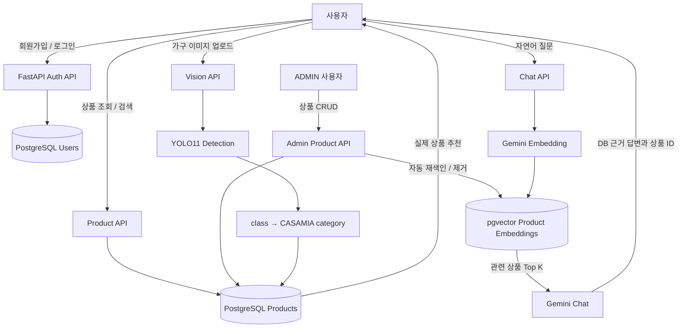
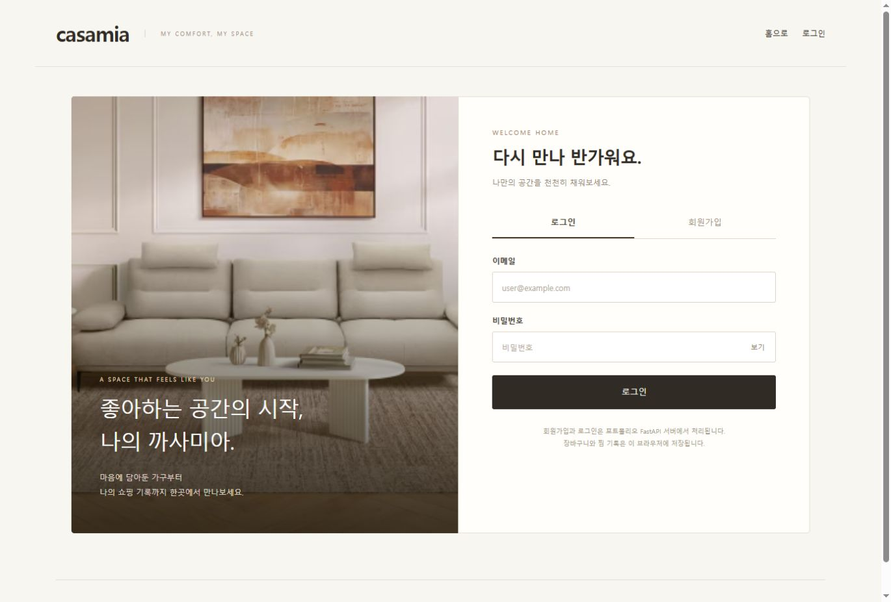
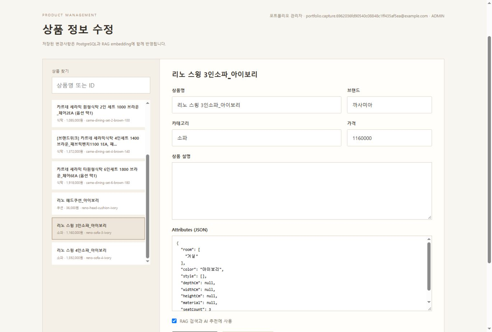
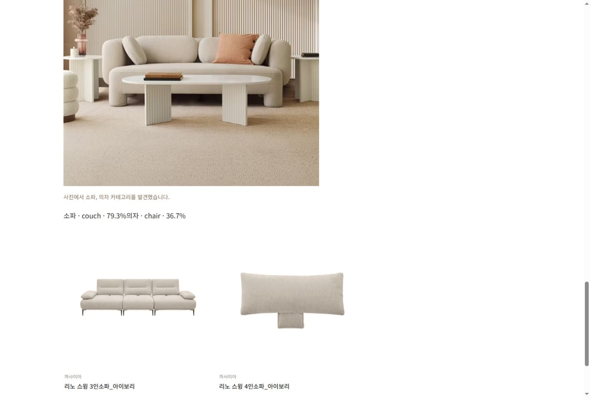

# CASAMIA AI Commerce Portfolio

> **정적 가구 쇼핑몰을 JWT 인증, PostgreSQL, pgvector RAG, YOLO11 기반 AI 커머스 시스템으로 확장한 포트폴리오 프로젝트**

기존 CASAMIA 쇼핑몰 UI를 유지하면서 정적 포트폴리오를 인증, 상품 관리, 자연어 상담, 이미지 기반 상품 탐색이 가능한 AI 커머스 시스템으로 확장한 프로젝트입니다. 프론트엔드는 HTML/CSS/Vanilla JavaScript를 유지하고, FastAPI와 PostgreSQL을 연결했습니다.

## 문제 → 개선

### 문제

초기 정적 쇼핑몰은 브라우저 데모 로그인, JSON 상품 데이터, 조건 기반 검색으로 동작했습니다. 상품 데이터와 사용자 권한을 서버에서 관리하지 않았고 자연어 상담이나 이미지 검색도 없었습니다.

### 개선

- 데모 로그인을 DB 사용자와 JWT 인증으로 교체했습니다.
- JSON 중심 상품 흐름을 PostgreSQL 상품 DB와 API로 전환했습니다.
- Gemini Embedding과 pgvector로 실제 상품 근거를 검색하는 RAG 상담을 구현했습니다.
- YOLO11로 개별 상품을 맞히는 대신 가구 카테고리를 탐지하고 실제 DB 상품과 연결했습니다.
- ADMIN 상품 변경 후 embedding이 자동으로 갱신되도록 데이터와 AI 검색 인덱스의 일관성을 유지했습니다.

## RAG와 YOLO11이 필요한 이유

| 구분 | 해결하려는 사용자 질문 | 입력 → 처리 → 결과 |
|---|---|---|
| RAG | “좁은 거실에 놓을 2인용 소파가 있을까?”처럼 상품 조건을 문장으로 설명할 때 | 자연어 질문 → Gemini Embedding과 pgvector로 관련 상품 검색 → 실제 DB 상품을 근거로 답변 |
| YOLO11 | 이름이나 카테고리를 모르는 가구 사진으로 비슷한 종류를 찾을 때 | 이미지 업로드 → 가구 객체 탐지 → 탐지 클래스를 CASAMIA 카테고리에 매핑해 실제 DB 상품 제시 |

RAG는 **텍스트의 의미와 상품 조건**을 연결하고, YOLO11은 **이미지 속 가구 유형**을 찾아 검색의 출발점을 만듭니다. 두 기능 모두 최종 추천은 PostgreSQL 상품 데이터에 연결합니다. YOLO11은 사진 속 CASAMIA 개별 상품을 식별하는 모델은 아닙니다.

## 핵심 구현

- JWT payload의 role만 신뢰하지 않고 요청마다 DB의 사용자와 현재 권한을 확인합니다.
- 상품 변경 트랜잭션 이후 해당 상품의 embedding을 생성·갱신·삭제합니다.
- vector similarity threshold를 적용해 날씨나 코딩 질문에 상품을 억지로 추천하지 않습니다.
- RAG 응답의 추천 ID, 이름, 가격은 PostgreSQL에 존재하는 상품을 기준으로 구성합니다.
- YOLO11은 `couch`, `chair`, `dining table`, `bed`를 CASAMIA 카테고리로 명시적으로 매핑하며 지원하지 않는 객체는 추천에서 제외합니다.

## 검증 결과

- 백엔드 단위·API 테스트: **23개 통과**. RAG의 상품 문서·필터·유사도 기준·인덱스 동기화와 YOLO11의 업로드 검증·카테고리 매핑·응답 스키마를 확인했습니다.
- 프론트엔드 Node 테스트: **2개 스크립트 통과**. 인증 흐름과 장바구니·찜·주문 상태를 확인했습니다.
- 아래 명령을 실행해 결과를 확인했습니다. 이 테스트는 외부 Gemini API, 실제 YOLO 추론, 운영 PostgreSQL을 통합 검증한 결과로 해석하지 않습니다.

```powershell
cd backend
.\.venv\Scripts\Activate.ps1
python -m unittest discover -s tests -v

cd ..
node tests/account.test.cjs
node tests/shop.test.cjs
```

### 개발 데이터 스냅샷

현재 포트폴리오 검증 데이터는 다음과 같습니다. 운영 고정값이 아니라 seed 및 개발 DB 상태를 설명하는 예시 수치입니다.

- `products`: 9개
- `rag_enabled=true`: 8개
- `product_embeddings`: 8개

## 핵심 기능

- JWT 기반 회원가입·로그인과 USER/ADMIN 권한 분리
- PostgreSQL 상품 데이터 조회·검색과 ADMIN 상품 CRUD
- Gemini Embedding + PostgreSQL pgvector 기반 RAG 상품 상담
- 상품 생성·수정·삭제 및 `rag_enabled` 변경 시 embedding 자동 동기화
- 관련성 threshold를 이용한 무관 질문 차단
- YOLO11 가구 객체 탐지와 CASAMIA 카테고리 매핑
- 탐지 카테고리와 일치하는 실제 DB 상품 추천
- 기존 상품 상세, 장바구니, 찜 UI 유지

## 사용자 시나리오

1. 사용자가 회원가입 후 JWT 기반으로 로그인합니다.
2. 자연어로 예산, 공간, 좌석 수 등의 상품 조건을 질문합니다.
3. RAG가 pgvector에서 관련 정보를 검색해 실제 DB 상품을 추천합니다.
4. 관리자가 ADMIN 화면에서 상품 가격이나 설명을 수정합니다.
5. 변경된 상품 문서와 embedding이 자동으로 갱신됩니다.
6. 사용자가 가구 이미지를 업로드하면 YOLO11이 가구 유형을 탐지합니다.
7. 탐지된 카테고리를 기준으로 PostgreSQL의 실제 상품을 추천합니다.

## 기술 스택

| 영역 | 기술 |
|---|---|
| Frontend | HTML, CSS, Vanilla JavaScript |
| Backend | FastAPI, Python, SQLAlchemy, Alembic |
| Database | PostgreSQL, pgvector |
| AI | Gemini Embedding, Gemini Chat, YOLO11 |
| Authentication | JWT, Argon2 password hashing |

## 아키텍처



## 주요 화면

| 로그인 화면 | RAG 챗봇 추천 화면 |
|---|---|
|  |  |
| **ADMIN 상품 수정 화면** | **YOLO11 이미지 탐지·추천 결과** |
|  |  |

## 주요 디렉터리

```text
backend/
  app/
    api/          FastAPI 라우터
    core/         환경설정과 보안 설정
    db/           SQLAlchemy 세션과 Base
    models/       User, Product, ProductEmbedding 모델
    schemas/      요청·응답 스키마
    services/     RAG와 YOLO 서비스
  alembic/        DB migration
  scripts/        상품 import, embedding index, ADMIN 생성
  tests/          백엔드 테스트
css/              기존 화면 스타일
img/              기존 상품 및 UI 이미지
js/               Vanilla JS 화면 로직과 공통 API 모듈
json/             초기 상품 및 기존 화면용 데이터
```

## 주요 API

| Method | Endpoint | 설명 | 권한 |
|---|---|---|---|
| GET | `/health` | 애플리케이션 상태 | 공개 |
| GET | `/health/db` | PostgreSQL 연결 상태 | 공개 |
| POST | `/api/v1/auth/register` | 회원가입 | 공개 |
| POST | `/api/v1/auth/login` | JWT 발급 | 공개 |
| GET | `/api/v1/users/me` | 현재 사용자 | JWT |
| GET | `/api/v1/products` | 전체 상품 | 공개 |
| GET | `/api/v1/products/search` | 조건 검색 | 공개 |
| GET | `/api/v1/products/{product_id}` | 상품 상세 | 공개 |
| POST/PATCH/DELETE | `/api/v1/admin/products...` | 상품 관리 | ADMIN |
| POST | `/api/v1/chat` | RAG 상품 상담 | 공개 |
| POST | `/api/v1/vision/detect` | 이미지 탐지와 상품 추천 | 공개 |

## 실행 준비

Windows PowerShell 기준입니다. PostgreSQL은 현재 개발 환경에서 18.x, 포트 `1101`을 사용합니다. 다른 포트를 사용할 경우 `.env`의 `DB_PORT`를 변경합니다.

### 1. 가상환경과 기본 의존성

```powershell
cd backend
py -m venv .venv
.\.venv\Scripts\Activate.ps1
python -m pip install -r requirements.txt
```

YOLO 이미지 탐색을 사용할 때만 선택 의존성을 설치합니다.

```powershell
python -m pip install -r requirements-yolo.txt
```

YOLO11 가중치는 최초 실행 시 Ultralytics 캐시에 내려받으며 Git에 포함하지 않습니다.

### 2. PostgreSQL과 pgvector

`casamia` 데이터베이스를 준비한 뒤 해당 DB에서 확장을 활성화합니다.

```sql
CREATE EXTENSION IF NOT EXISTS vector;
```

### 3. 환경변수

```powershell
Copy-Item .env.example .env
```

`.env`에서 DB 접속 정보, 충분히 긴 `JWT_SECRET_KEY`, `GEMINI_API_KEY`를 설정합니다. 실제 비밀값은 커밋하지 않습니다. 기본 개발 주소는 프론트엔드 `http://127.0.0.1:5500`, 백엔드 `http://127.0.0.1:8001`입니다.

### 4. migration과 초기 데이터

```powershell
alembic upgrade head
python scripts/import_products.py
python scripts/index_products.py
```

`index_products.py`는 Gemini API 키와 활성화된 pgvector 확장이 필요합니다. 재실행해도 상품별 embedding row가 중복 생성되지 않습니다.

### 5. 서버 실행

백엔드 터미널:

```powershell
cd backend
.\.venv\Scripts\Activate.ps1
python -m uvicorn app.main:app --host 127.0.0.1 --port 8001
```

프로젝트 루트의 별도 터미널:

```powershell
py -m http.server 5500
```

브라우저에서 `http://127.0.0.1:5500/index.html`을 엽니다. 프론트 API 주소는 `js/api.js`의 `DEFAULT_API_BASE_URL` 한 곳에서 관리합니다.

## 현재 한계

- 장바구니, 찜, 주문은 아직 브라우저 `localStorage`를 사용합니다.
- Gemini와 YOLO 모델 호출은 외부 API·모델 가용성과 로컬 연산 성능의 영향을 받습니다.
- YOLO11 사전학습 모델은 일반 객체 카테고리를 탐지하며 CASAMIA 개별 상품을 식별하지 않습니다.
- 개발용 단일 Access Token 흐름이며 refresh token, 이메일 인증, 비밀번호 재설정은 구현하지 않았습니다.
- 상품 seed는 9개로 작아 추천 다양성과 정량 평가 범위가 제한됩니다.
